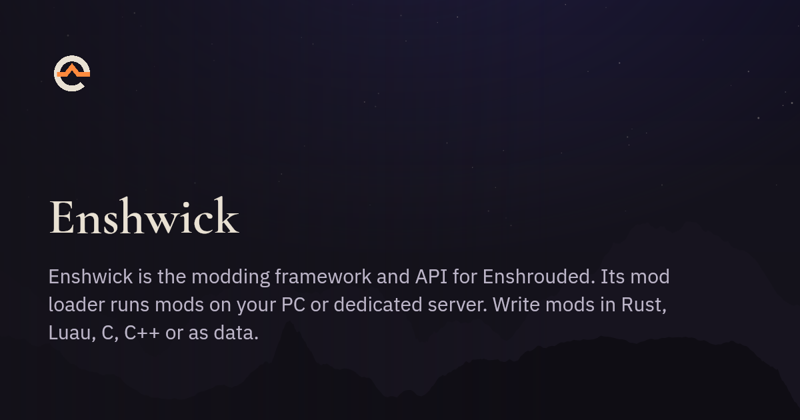

  

<!--
The site is the source of these words: the first paragraph is `site.description`
of src/data/texts.json in enshwick/docs, and banner.png is
https://enshwick.com/og/github/enshwick.png, which that site's build draws.
Change the words there first.
-->

Enshwick is the modding framework and API for
[Enshrouded](https://enshrouded.com). Its mod loader runs mods on your PC or
dedicated server. Write mods in Rust, Luau, C, C++ or as data.

Enshwick is in alpha: version 1.0 is not out yet. Until 1.0, anything may
change between alphas, so back up your saves before you update.

## For players

- Download `enshwick.zip` from the newest alpha on the
  [releases page](https://github.com/enshwick/enshwick/releases), or let Vortex
  install it from [Nexus Mods](https://www.nexusmods.com/site/mods/2511).
- [Your first modded game](https://enshwick.com/start/first-modded-game/) shows
  each step, on Windows, Linux and Steam Deck.
- [Mods by the Enshwick team](https://enshwick.com/#mods) lists our mods. Each
  one has a page that says what it changes.
- After a game update, Enshwick turns off what it cannot find in the new
  version of the game and names it in chat. Everything else keeps working.
  [Compatibility](https://enshwick.com/reference/compatibility/) lists the game
  versions each release runs on.

## For server admins

- Install Enshwick into the server's folder, as on a PC. Players need the same
  mods, except the mods that run only on the server:
  [play on a server](https://enshwick.com/guides/play-on-a-server/).
- A Linux server runs the Windows server under Wine or Proton:
  [run a Linux server](https://enshwick.com/guides/run-a-linux-server/) and
  [run a server in Docker or Kubernetes](https://enshwick.com/guides/run-a-server-in-docker/).
- Each world has its own mod settings, in files beside its save:
  [where the files are](https://enshwick.com/reference/where-files-live/).

## For mod makers

- Write a mod in Rust or Luau, or as plain data with no code. C and C++ work
  through the C header. [Getting started](https://enshwick.com/dev/getting-started/)
  creates a mod, puts it in the game and tests it without starting the game.
- The [developer docs](https://enshwick.com/dev/) explain the API, and
  [API coverage](https://enshwick.com/dev/api-coverage/) shows what it reaches
  today.
- The reference of the `enshwick` crate is on
  [docs.rs](https://docs.rs/enshwick).
- [What comes next](https://enshwick.com/aims/) lists the aims, without dates.

## Report a bug or ask for an API

- [Open an issue](https://github.com/enshwick/enshwick/issues/new/choose): a
  mod that does not work, a game update that broke something, an API call your
  mod needs, or an idea.
- Ask a question in
  [Discussions](https://github.com/enshwick/.github/discussions).
- Report a security problem privately, as the
  [security policy](https://github.com/enshwick/.github/blob/main/SECURITY.md)
  says.
- Pull requests are welcome. The
  [contributing guide](https://github.com/enshwick/.github/blob/main/CONTRIBUTING.md)
  explains how they work.
- Mail [contact@enshwick.com](mailto:contact@enshwick.com).

## Repositories

| Repository | What it holds |
| --- | --- |
| [enshwick](https://github.com/enshwick/enshwick) | the framework: the mod loader, the API, the `cargo enshwick` tool and the modding book |
| [mods](https://github.com/enshwick/mods) | our mods, each released on its own |
| [docs](https://github.com/enshwick/docs) | the source of [enshwick.com](https://enshwick.com) |
| [vortex-extension](https://github.com/enshwick/vortex-extension) | the Vortex extension that installs Enshwick and its mods |

Enshwick and our mods are free, and their code is open under the MIT licence.
Enshrouded is a game by Keen Games. Enshwick is not affiliated with Keen Games.
